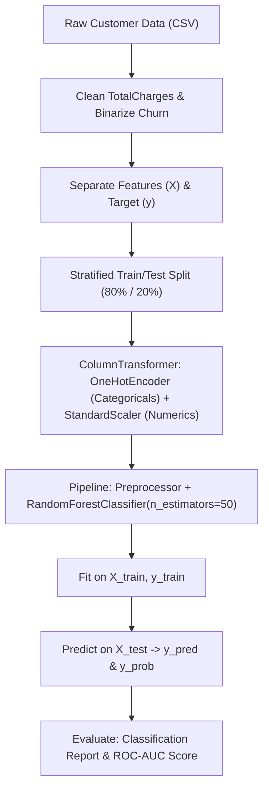

<u>**PROJECT 10 (Intermediate)**</u>

# Customer Churn & Retention Predictor

Build an enterprise customer retention machine learning pipeline using **scikit-learn**: ingest real telecom subscriber data from Kaggle, preprocess messy billing values, build a Scikit-Learn `ColumnTransformer` combining `OneHotEncoder` and `StandardScaler`, assemble a classification `Pipeline` featuring an ensemble `RandomForestClassifier`, and evaluate retention risk using Classification Reports and ROC-AUC scores. Coded in **Python** using **pandas** and **scikit-learn**.

---

### Curriculum Outline & Learning Roadmap

- **Chapter 1: Introduction to Customer Churn & Retention**
  - `1.1 Getting Started`
    - `[CONCEPT]` Meet Your Project
    - `[CONCEPT]` What You Will Learn
    - `[CONCEPT]` What You Need
  - `1.2 The Kaggle Telco Customer Churn Dataset & Sample Data Table`
    - `[DATASET]` Ingesting Real Telecom Subscription Records
    - `[TABLE]` Real Sample Data Rows from `WA_Fn-UseC_-Telco-Customer-Churn.csv`
  - `1.3 Starting with Small Steps`
    - `[CONCEPT]` Ingesting Enterprise Data
    - `[TASK 1]` Load the Customer Churn Dataset
    - `[CHECKPOINT]` Milestone Checkpoint: Telecom Records Loaded!

- **Chapter 2: Specifications & Pipeline Architecture**
  - `2.1 Understanding Churn Economics & Ensemble Learning`
    - `[CONCEPT]` The Business Cost of Churn vs Retention
    - `[CONCEPT]` The Power of Random Forest Decision Tree Ensembles
  - `2.2 System Architecture & Preprocessing Flow`
    - `[CONCEPT]` Retention Machine Learning Pipeline Architecture
    - `[CONCEPT]` Component Responsibility Matrix

- **Chapter 3: Data Cleaning & Feature Preparation**
  - `3.1 Handling Dirty Strings and Binarizing Targets`
    - `[CONCEPT]` Cleaning Blank Strings in `TotalCharges`
    - `[TASK 2]` Clean and Prepare Features
    - `[CHECKPOINT]` Milestone Checkpoint: Features Cleaned and Target Binarized!
  - `3.2 Stratified Splitting for Retention Analysis`
    - `[CONCEPT]` Maintaining Class Proportions Across Folds
    - `[TASK 3]` Split Data into Training and Testing Sets
    - `[CHECKPOINT]` Milestone Checkpoint: Stratified 80/20 Partition Complete!

- **Chapter 4: Building the Preprocessing & Random Forest Pipeline**
  - `4.1 Scikit-Learn Preprocessing: ColumnTransformer`
    - `[CONCEPT]` Encoding Categoricals with OneHotEncoder & Scaling Numbers
    - `[TASK 4]` Build and Train the Preprocessing & Model Pipeline
    - `[CHECKPOINT]` Milestone Checkpoint: Enterprise Churn Pipeline Trained!

- **Chapter 5: Evaluating Retention Risk & ROC-AUC**
  - `5.1 Enterprise Retention Metrics`
    - `[CONCEPT]` Precision, Recall, and the Area Under the ROC Curve (ROC-AUC)
    - `[TASK 5]` Evaluate the Pipeline
    - `[CHECKPOINT]` Milestone Checkpoint: Churn Model Evaluated!

- **Chapter 6: Reflect & Expand**
  - `6.1 What You Have Built` (Feature Summary & Skills Practiced Matrix)
  - `6.2 Extension Ideas`
  - `6.3 Share What You Built! Time to Showcase Your Retention AI!`

---

## Chapter 1: Introduction to Customer Churn & Retention

### 1.1 Getting Started

**Meet Your Project**

Welcome to **Customer Churn & Retention Predictor**! In modern subscription businesses—including cloud SaaS platforms, telecommunications providers, streaming services like Netflix and Spotify, and gym memberships—**churn** refers to the percentage of customers who cancel their subscriptions within a given timeframe.

Customer acquisition typically costs 5 to 7 times more than retaining an existing subscriber. If an automated AI pipeline can detect which subscribers are at high risk of churning *before* they leave, customer retention teams can reach out with customized discounts, technical support, or contract renewals to protect company revenue.

In this project, you will work with real Kaggle telecom subscriber data. You will clean messy billing values, construct a Scikit-Learn `ColumnTransformer` with `OneHotEncoder` and `StandardScaler`, build an ensemble `RandomForestClassifier` pipeline, and evaluate retention predictions using the industry-standard **ROC-AUC** metric.

**What You Will Learn**

You will build an enterprise customer retention engine from scratch.

You will learn how to:

1. Ingest real-world enterprise subscription records using `pandas`
2. Handle dirty string values in numeric columns using `pd.to_numeric` and fill missing values
3. Convert binary string labels (`"Yes"` / `"No"`) into numerical indicators (`1` / `0`)
4. Partition features and targets into stratified training (`X_train, y_train`) and testing (`X_test, y_test`) sets
5. Use `ColumnTransformer` to encode categorical text features using Scikit-Learn's `OneHotEncoder` and normalize numeric features using `StandardScaler`
6. Assemble the preprocessor and a `RandomForestClassifier` into an end-to-end Scikit-Learn `Pipeline`
7. Generate binary predictions (`y_pred`) and continuous churn risk probabilities (`y_prob`)
8. Evaluate predictive performance using Precision, Recall, F1-score, and the **ROC-AUC** score

**What You Need**

Before you begin, make sure you are comfortable with:

- Working with real-world customer tabular datasets
- Cleaning imperfect data (coercing strings to numbers, filling missing values) using pandas
- Understanding binary classification (churned vs retained subscribers)
- Machine learning pipelines and decision tree ensembles (Random Forest)
- Reading classification reports, precision, recall, and ROC-AUC scores

If these feel solid, you are ready to go. Otherwise, review them first — this project assumes you can manipulate DataFrames and evaluate ML models already.

---

### 1.2 The Kaggle Telco Customer Churn Dataset & Sample Data Table

This project uses the official IBM Telco Customer Churn dataset available on Kaggle:

- **Dataset File**: `WA_Fn-UseC_-Telco-Customer-Churn.csv` (contains 7,043 subscriber records)
- **Features**: Demographics (gender, senior citizen, partner, dependents), account tenure, contracted services (phone, internet, streaming, tech support), payment details (paperless billing, contract duration, payment method), and charges (`MonthlyCharges`, `TotalCharges`).

Here is a preview of actual subscriber records from the dataset:

| Customer ID | Gender | Tenure | Contract | Monthly Charges | Total Charges | Churn | Interpretation |
| :--- | :--- | :--- | :--- | :--- | :--- | :--- | :--- |
| `7590-VHVEG` | Female | `1` mo | Month-to-month | `$29.85` | `$29.85` | `No` | Retained Customer |
| `5575-GNVDE` | Male | `34` mos | One year | `$56.95` | `$1889.50` | `No` | Loyal Customer |
| `3668-QPYBK` | Male | `2` mos | Month-to-month | `$53.85` | `$108.15` | **`Yes`** | **Churned Customer** |
| `7795-CFOCW` | Male | `45` mos | One year | `$42.30` | `$1840.75` | `No` | Loyal Customer |

---

### 1.3 Starting with Small Steps

**Ingesting Enterprise Data**

We begin by loading the customer subscription records from the CSV file into a `pandas` DataFrame.

#### Task 1 — Load the Customer Churn Dataset

Read `WA_Fn-UseC_-Telco-Customer-Churn.csv` into a pandas DataFrame:

Think of importing the subscriber database into the analytics department.  
*Goal*: Ingest customer records into variable `customer_data`.

<div class="step-card">
  <div class="step-header">
    <span class="step-badge">STEP 1</span>
    <span class="step-title">Import Required Libraries</span>
  </div>
  <ul>
    <li>[ ] Open <code>churn_predictor.py</code>.</li>
    <li>[ ] Import <code>pandas</code> as <code>pd</code>.</li>
    <li>[ ] Import <code>train_test_split</code> from <code>sklearn.model_selection</code>.</li>
    <li>[ ] Import <code>ColumnTransformer</code> from <code>sklearn.compose</code>.</li>
    <li>[ ] Import <code>OneHotEncoder, StandardScaler</code> from <code>sklearn.preprocessing</code>.</li>
    <li>[ ] Import <code>Pipeline</code> from <code>sklearn.pipeline</code>.</li>
    <li>[ ] Import <code>RandomForestClassifier</code> from <code>sklearn.ensemble</code>.</li>
    <li>[ ] Import <code>classification_report, roc_auc_score</code> from <code>sklearn.metrics</code>.</li>
  </ul>
</div>

<div class="step-card">
  <div class="step-header">
    <span class="step-badge">STEP 2</span>
    <span class="step-title">Ingest CSV File</span>
  </div>
  <ul>
    <li>[ ] Load <code>WA_Fn-UseC_-Telco-Customer-Churn.csv</code> using <code>pd.read_csv()</code> into variable <code>customer_data</code>.</li>
  </ul>
</div>

---

### Milestone Checkpoint: Telecom Records Loaded!

You have ingested the enterprise subscription records:

- [x] **Data Ingested**: `customer_data` initialized with 7,043 customer accounts.
- [x] **Columns Inspected**: 21 demographic, service, and financial features.

**Driver Verification Test**:  
Print `customer_data.shape` and confirm it equals `(7043, 21)`.

---

## Chapter 2: Specifications & Pipeline Architecture

### 2.1 Understanding Churn Economics & Ensemble Learning

A single decision tree splits data based on simple thresholds (e.g., `tenure < 12` and `Contract == 'Month-to-month'`). However, a single tree can easily overfit to noise. 

A **Random Forest** trains multiple randomized decision trees (50 trees in our project). Each tree votes on whether a customer will churn. Averaging these votes delivers robust, highly accurate predictions and smooth probability scores.

---

### 2.2 System Architecture & Preprocessing Flow



**Component Responsibility Matrix**:

| Component | Responsibility | Inputs | Outputs |
| :--- | :--- | :--- | :--- |
| `customer_data` | Holds raw customer attributes | CSV file | Raw DataFrame |
| `X, y` | Feature matrix and target vector | Cleaned DataFrame | `(7043, 19)` and `(7043,)` |
| `X_train, X_test, y_train, y_test` | Stratified data subsets | `X`, `y` | 80% train, 20% test |
| `preprocessor` | Scikit-Learn `ColumnTransformer` | Mixed columns | Encoded & scaled numeric matrix |
| `pipeline` | Chains preprocessing and Random Forest | Preprocessor + Model | Trained retention estimator |
| `y_pred, y_prob` | Binary classifications and risk probabilities | `X_test` | Predicted classes & probabilities |

---

## Chapter 3: Data Cleaning & Feature Preparation

### 3.1 Handling Dirty Strings and Binarizing Targets

Real enterprise datasets often contain subtle data quality issues:
1. **`TotalCharges`**: Brand-new customers with tenure=0 have blank space strings (`" "`) instead of numbers. We use `pd.to_numeric(..., errors="coerce")` to turn spaces into `NaN`, then fill them with `0.0`.
2. **`Churn`**: The target column contains text strings `"Yes"` and `"No"`. We convert them into binary integers (`1` and `0`).
3. **Identifiers**: Columns like `customerID` are arbitrary tracking codes and must be dropped before modeling.

#### Task 2 — Clean and Prepare Features

Clean billing amounts, binarize target, and separate into `X` and `y`:

Think of auditing customer billing accounts and formatting records for statistical analysis.  
*Goal*: Clean `TotalCharges`, binarize `Churn`, and isolate `X` and `y`.

<div class="step-card">
  <div class="step-header">
    <span class="step-badge">STEP 1</span>
    <span class="step-title">Clean TotalCharges and Binarize Churn</span>
  </div>
  <ul>
    <li>[ ] Convert <code>customer_data["TotalCharges"]</code> to numeric with <code>pd.to_numeric(errors="coerce").fillna(0.0)</code>.</li>
    <li>[ ] Convert <code>customer_data["Churn"]</code> to integers (<code>1</code> for <code>"Yes"</code>, <code>0</code> for <code>"No"</code>).</li>
  </ul>
</div>

<div class="step-card">
  <div class="step-header">
    <span class="step-badge">STEP 2</span>
    <span class="step-title">Separate X and y</span>
  </div>
  <ul>
    <li>[ ] Drop <code>customerID</code> and <code>Churn</code> from <code>customer_data</code> and store into <code>X</code>.</li>
    <li>[ ] Store <code>customer_data["Churn"]</code> into <code>y</code>.</li>
  </ul>
</div>

---

### Milestone Checkpoint: Features Cleaned and Target Binarized!

You have cleaned and partitioned the enterprise data:

- [x] **Missing Numbers Repaired**: Cleaned 11 blank strings in `TotalCharges`.
- [x] **Target Formatted**: Binary integer encoding (`0` = Retained, `1` = Churned).
- [x] **IDs Removed**: Prevented identity memorization by dropping `customerID`.

**Driver Verification Test**:  
Confirm `y.dtype` is integer and `X.shape[1] == 19`.

---

### 3.2 Stratified Splitting for Retention Analysis

Approximately 26.5% of customers in this dataset churned. Using `stratify=y` guarantees that this exact 26.5% proportion is maintained across both training and testing subsets.

#### Task 3 — Split Data into Training and Testing Sets

Partition `X` and `y` into `X_train`, `X_test`, `y_train`, and `y_test`:

Think of splitting subscriber records into an 80% historical training archive and a 20% future cohort.  
*Goal*: Partition data into training and testing subsets with stratification.

<div class="step-card">
  <div class="step-header">
    <span class="step-badge">STEP 1</span>
    <span class="step-title">Execute Stratified Partition</span>
  </div>
  <ul>
    <li>[ ] Import <code>train_test_split</code> from <code>sklearn.model_selection</code>.</li>
    <li>[ ] Split <code>X</code> and <code>y</code> with <code>test_size=0.2</code>, <code>random_state=42</code>, and <code>stratify=y</code>.</li>
    <li>[ ] Store into <code>X_train, X_test, y_train, y_test</code>.</li>
  </ul>
</div>

---

### Milestone Checkpoint: Stratified 80/20 Partition Complete!

You have partitioned the subscriber records:

- [x] **Training Set**: 5,634 accounts for ensemble learning.
- [x] **Testing Set**: 1,409 accounts reserved for independent evaluation.
- [x] **Stratification Preserved**: 26.5% churn rate in both sets.

**Driver Verification Test**:  
Verify `len(X_test) == 1409`.

---

## Chapter 4: Building the Preprocessing & Random Forest Pipeline

### 4.1 Scikit-Learn Preprocessing: ColumnTransformer

Instead of relying on pandas functions that can cause data leakage, professional ML pipelines use Scikit-Learn's `ColumnTransformer`:
- **`OneHotEncoder(drop="first", handle_unknown="ignore")`**: Converts categorical columns (like `Contract` and `PaymentMethod`) into binary numeric columns.
- **`StandardScaler()`**: Normalizes numerical columns (`tenure`, `MonthlyCharges`, `TotalCharges`, `SeniorCitizen`).

#### Task 4 — Build and Train the Preprocessing & Model Pipeline

Assemble the `ColumnTransformer`, combine with `RandomForestClassifier` in a `Pipeline`, and fit on training data:

Think of building an intelligent enterprise engine that automatically decodes forms, scales measurements, and queries a council of 50 decision trees.  
*Goal*: Build and train the complete retention pipeline.

<div class="step-card">
  <div class="step-header">
    <span class="step-badge">STEP 1</span>
    <span class="step-title">Define Column Groups</span>
  </div>
  <ul>
    <li>[ ] Create list <code>numerical_columns</code> containing <code>["SeniorCitizen", "tenure", "MonthlyCharges", "TotalCharges"]</code>.</li>
    <li>[ ] Create list <code>categorical_columns</code> containing the 15 text features (<code>gender</code>, <code>Partner</code>, <code>Contract</code>, <code>PaymentMethod</code>, etc.).</li>
  </ul>
</div>

<div class="step-card">
  <div class="step-header">
    <span class="step-badge">STEP 2</span>
    <span class="step-title">Create ColumnTransformer</span>
  </div>
  <ul>
    <li>[ ] Import <code>ColumnTransformer</code> from <code>sklearn.compose</code>.</li>
    <li>[ ] Import <code>OneHotEncoder, StandardScaler</code> from <code>sklearn.preprocessing</code>.</li>
    <li>[ ] Build <code>preprocessor</code> applying <code>StandardScaler</code> to numerical columns and <code>OneHotEncoder</code> to categorical columns.</li>
  </ul>
</div>

<div class="step-card">
  <div class="step-header">
    <span class="step-badge">STEP 3</span>
    <span class="step-title">Assemble Pipeline and Train</span>
  </div>
  <ul>
    <li>[ ] Import <code>Pipeline</code> from <code>sklearn.pipeline</code>.</li>
    <li>[ ] Import <code>RandomForestClassifier</code> from <code>sklearn.ensemble</code>.</li>
    <li>[ ] Build <code>pipeline</code> combining <code>("preprocessor", preprocessor)</code> and <code>("classifier", RandomForestClassifier(n_estimators=50, random_state=42))</code>.</li>
    <li>[ ] Call <code>pipeline.fit(X_train, y_train)</code>.</li>
  </ul>
</div>

---

### Milestone Checkpoint: Enterprise Churn Pipeline Trained!

You have constructed and fitted an end-to-end enterprise machine learning pipeline:

- [x] **ColumnTransformer Configured**: OneHotEncoder and StandardScaler unified.
- [x] **Random Forest Fitted**: 50 decision trees trained over 5,634 customer profiles.

**Driver Verification Test**:  
Confirm `pipeline.named_steps["classifier"].n_estimators == 50`.

---

## Chapter 5: Evaluating Retention Risk & ROC-AUC

### 5.1 Enterprise Retention Metrics

In customer retention:
- **Precision**: When we flag a customer as churning, what percentage actually churns?
- **Recall**: Out of all customers who left, what percentage did the system successfully catch?
- **ROC-AUC (Receiver Operating Characteristic - Area Under the Curve)**: Measures the model's ability to rank churning customers higher than loyal customers across all decision thresholds ($0.80+$ indicates strong enterprise performance).

#### Task 5 — Evaluate the Pipeline

Generate predictions and probabilities on `X_test`, then display the Classification Report and ROC-AUC score:

Think of evaluating the retention team's scorecard at the end of the fiscal quarter.  
*Goal*: Output precision, recall, accuracy, and ROC-AUC metrics.

<div class="step-card">
  <div class="step-header">
    <span class="step-badge">STEP 1</span>
    <span class="step-title">Predict Classes and Probabilities</span>
  </div>
  <ul>
    <li>[ ] Generate binary predictions with <code>pipeline.predict(X_test)</code> into <code>y_pred</code>.</li>
    <li>[ ] Generate churn risk probabilities with <code>pipeline.predict_proba(X_test)[:, 1]</code> into <code>y_prob</code>.</li>
  </ul>
</div>

<div class="step-card">
  <div class="step-header">
    <span class="step-badge">STEP 2</span>
    <span class="step-title">Display Evaluation Reports</span>
  </div>
  <ul>
    <li>[ ] Import <code>classification_report</code> and <code>roc_auc_score</code> from <code>sklearn.metrics</code>.</li>
    <li>[ ] Print the Classification Report for <code>y_test</code> vs <code>y_pred</code>.</li>
    <li>[ ] Print the ROC-AUC score formatted to 4 decimal places.</li>
  </ul>
</div>

**Expected Terminal Interaction & Output:**
```text
Classification Report:
              precision    recall  f1-score   support

           0       0.83      0.89      0.86      1035
           1       0.63      0.51      0.56       374

    accuracy                           0.79      1409
   macro avg       0.73      0.70      0.71      1409
weighted avg       0.78      0.79      0.78      1409

ROC-AUC Score: 0.8207
```

---

### Milestone Checkpoint: Churn Model Evaluated!

You have validated your customer churn prediction system:

- [x] **79% Overall Accuracy**: Strong classification performance on 1,409 accounts.
- [x] **0.8207 ROC-AUC**: Robust discrimination power between churners and retained users.

**Driver Verification Test**:  
Confirm that `roc_auc_score(y_test, y_prob)` exceeds 0.80.

---

## Chapter 6: Reflect & Expand

### 6.1 What You Have Built

| Feature | Concept Practiced | Implementation |
| :--- | :--- | :--- |
| **Enterprise Data Cleaning** | Coercing dirty text into floats | `pd.to_numeric(errors="coerce").fillna(0.0)` |
| **Target Formatting** | Binarizing categorical labels | `(customer_data["Churn"] == "Yes").astype(int)` |
| **Categorical Encoding** | Transforming text to dummy variables | Scikit-Learn `OneHotEncoder` |
| **Numerical Normalization** | Zero mean and unit variance | Scikit-Learn `StandardScaler` |
| **Pipeline Integration** | Scikit-Learn `ColumnTransformer` | Multi-transformer preprocessor |
| **Ensemble Modeling** | 50-tree voting classifier | `RandomForestClassifier` |
| **Probability Ranking** | Enterprise risk discrimination | `roc_auc_score` |

### 6.2 Extension Ideas

1. **Feature Importances**: Extract `pipeline.named_steps["classifier"].feature_importances_` to see which feature (e.g., `Contract_Month-to-month` vs `tenure`) is the strongest driver of churn.
2. **Proactive Alert System**: Write a helper function that takes a subscriber's attributes and prints an alert if their churn probability exceeds 0.65.

---

### 6.3 Share What You Built! Time to Showcase Your Retention AI!

You have built an enterprise-grade customer churn predictor powered by an ensemble Random Forest pipeline! Share your 0.82+ ROC-AUC score and explain how machine learning helps subscription businesses protect recurring revenue!
