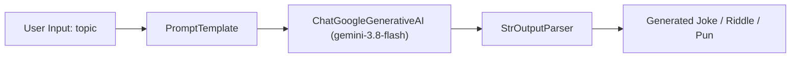

<u>**PROJECT 6 (Basic)**</u>

# AI Joke & Riddle Generator

Build a modern Generative AI application using **LangChain** and **Google Gemini 3.8 Flash**: learn how Large Language Models (LLMs) interpret natural language prompts, construct dynamic `PromptTemplate` objects, chain prompt-model-output components together using LangChain Expression Language (LCEL), deliver comedy routines and multi-part riddle challenges, and configure your own free Gemini API key. Coded in **Python** using **LangChain** and **Google Gemini API**.

---

### Curriculum Outline & Learning Roadmap

- **Chapter 1: Introduction to Generative AI & Setup**
  - `1.1 Getting Started`
    - `[CONCEPT]` Meet Your Project
    - `[CONCEPT]` What You Will Learn
    - `[CONCEPT]` What You Need
  - `1.2 Starting with Small Steps: API Key Configuration`
    - `[CONCEPT]` How LLM API Authentication Works
    - `[TASK 1]` Set Your Google Gemini API Key
    - `[CHECKPOINT]` Milestone Checkpoint: Free API Key Generated & Configured!

- **Chapter 2: Specifications & LangChain Pipeline Architecture**
  - `2.1 Understanding LangChain Core Abstractions`
    - `[CONCEPT]` What is LangChain? The Modular Building Blocks of AI
    - `[CONCEPT]` Prompt Templates and the LCEL Pipe Operator
  - `2.2 System Architecture & Execution Flow`
    - `[CONCEPT]` Chronological GenAI Chain Execution (4 Stages)
    - `[CONCEPT]` Component Responsibility Matrix

- **Chapter 3: Connecting to the Gemini 3.8 Flash Model**
  - `3.1 Model Initialization & Temperature`
    - `[CONCEPT]` The Power of Gemini 3.8 Flash
    - `[TASK 2]` Initialize the Gemini Model
    - `[CHECKPOINT]` Milestone Checkpoint: Gemini 3.8 Flash LLM Instance Active!

- **Chapter 4: Building Humor & Riddle Chains with LangChain**
  - `4.1 Prompt Engineering for Stand-Up Comedy`
    - `[CONCEPT]` Structuring Prompts for Humor
    - `[TASK 3]` Create the Joke Generator Chain
    - `[CHECKPOINT]` Milestone Checkpoint: Comedic Joke Pipeline Operational!
  - `4.2 Multi-Part Structured Puzzle Challenges`
    - `[CONCEPT]` Generating Riddles, Clues, and Hidden Answers
    - `[TASK 4]` Create the Riddle Challenge Chain
    - `[CHECKPOINT]` Milestone Checkpoint: Interactive Riddle Challenge Operational!
  - `4.3 Rapid Linguistic Synthesis & Wordplay`
    - `[CONCEPT]` Engineering Puns on Dynamic Keywords
    - `[TASK 5]` Create the Pun Generator Chain
    - `[CHECKPOINT]` Milestone Checkpoint: Pun Generation Pipeline Operational!

- **Chapter 5: Terminal Interaction & Menu Orchestration**
  - `5.1 Turn-Based CLI Menu Routing`
    - `[CONCEPT]` Connecting Chains to User Terminal Prompts
    - `[TASK 6]` Build the Interactive Menu and Application Loop
    - `[CHECKPOINT]` Milestone Checkpoint: Full GenAI Application Complete!

- **Chapter 6: Reflect & Expand**
  - `6.1 What You Have Built` (Feature Summary & Skills Practiced Matrix)
  - `6.2 Extension Ideas`
  - `6.3 Share What You Built! Time to Showcase Your GenAI App!`

---

## Chapter 1: Introduction to Generative AI & Setup

### 1.1 Getting Started

**Meet Your Project**

Welcome to your first **Generative AI (GenAI)** project! You are about to build an **AI Joke & Riddle Generator** powered by Google's cutting-edge **Gemini 3.8 Flash** model and orchestrated with **LangChain** — the industry-standard framework for building LLM-powered applications.

Unlike traditional rule-based programs that rely on pre-written responses or static lists, this project connects to a true Large Language Model capable of understanding any topic on Earth. When a user asks for a joke about *"quantum computers"*, *"Monday mornings"*, or *"debugging at midnight"*, your program dynamically constructs a prompt, communicates with Gemini 3.8 Flash, and delivers fresh, creative content in real time!

**What You Will Learn**

You will build a full Generative AI application from scratch.

You will learn how to:

1. Obtain a 100% free API key from Google AI Studio
2. Securely configure your secret key inside your application script
3. Initialize the `ChatGoogleGenerativeAI` model with `gemini-3.8-flash`
4. Construct reusable `PromptTemplate` objects with dynamic slot filling
5. Chain prompts, models, and string parsers using modern LangChain Expression Language (LCEL) pipe syntax (`|`)
6. Engineer specialized prompts for jokes, multi-part riddles with hints, and puns
7. Build an interactive command-line interface that routes user topic requests to the appropriate AI chain

**What You Need**

Before you begin, make sure you are comfortable with:

- Printing formatted output and reading user input from the terminal
- Variables, strings, dictionaries, and conditional logic (`if` / `elif` / `else`)
- Writing clean functions and importing Python libraries
- Basic concepts of Generative AI and web API keys
- Navigating web applications (to generate your free Google AI Studio key)

If these feel solid, you are ready to go. Otherwise, review them first — this project assumes you can write basic Python code already.

---

### 1.2 Starting with Small Steps: API Key Configuration

**How LLM API Authentication Works**

Before your code can communicate with Google's servers, it must present a digital pass known as an **API Key**. Google AI Studio provides developers with free access to Gemini models. In this task, you will generate your own free key and configure your project entry file.

#### Task 1 — Set Your Google Gemini API Key

Create your project entry file `joke_riddle_generator.py` and assign your free Gemini API key to `GEMINI_API_KEY`:

Think of picking up a backstage VIP badge that lets you enter the AI studio.  
*Goal*: Obtain a free key from Google and configure the top-level script variable.

<div class="step-card">
  <div class="step-header">
    <span class="step-badge">STEP 1</span>
    <span class="step-title">Import LangChain Modules</span>
  </div>
  <ul>
    <li>[ ] Open <code>joke_riddle_generator.py</code>.</li>
    <li>[ ] Import <code>PromptTemplate</code> from <code>langchain_core.prompts</code>.</li>
    <li>[ ] Import <code>ChatGoogleGenerativeAI</code> from <code>langchain_google_genai</code>.</li>
    <li>[ ] Import <code>StrOutputParser</code> from <code>langchain_core.output_parsers</code>.</li>
  </ul>
</div>

Think of setting up your project workbench and placing your key in safe storage.  
*Goal*: Create the script file and declare the API key variable.

<div class="step-card">
  <div class="step-header">
    <span class="step-badge">STEP 2</span>
    <span class="step-title">Configure Free Gemini API Key</span>
  </div>
  <ul>
    <li>[ ] Visit <strong>https://aistudio.google.com/</strong>, sign in with your Google account, and click <strong>"Get API key"</strong> -> <strong>"Create API key in new project"</strong>.</li>
    <li>[ ] Copy your generated secret key string (starts with <code>AIzaSy...</code>).</li>
    <li>[ ] Declare variable <code>GEMINI_API_KEY</code> and paste your key string.</li>
  </ul>
</div>

---

### Milestone Checkpoint: Free API Key Generated & Configured!

You have completed the essential authentication setup:

- [x] **Key Acquired**: Generated a free API key from Google AI Studio.
- [x] **Script Variable Set**: Defined `GEMINI_API_KEY` at line 7 of `joke_riddle_generator.py`.

**Driver Verification Test**:  
Verify that `GEMINI_API_KEY` is a non-empty string starting with `"AIzaSy"`.

---

## Chapter 2: Specifications & LangChain Pipeline Architecture

### 2.1 Understanding LangChain Core Abstractions

LangChain simplifies working with Large Language Models by breaking down AI workflows into three modular components:

1. **`PromptTemplate`**: A template string with dynamic input slots (e.g. `{topic}`). It formats raw user text into structured instructions for the AI.
2. **`ChatGoogleGenerativeAI`**: The model wrapper that sends your formatted prompt over HTTPS to Google's Gemini servers and retrieves the AI's response.
3. **`StrOutputParser`**: Extracts the clean, readable text from the raw AI response object so your program can display it directly.

---

### 2.2 System Architecture & Execution Flow



**Chronological GenAI Chain Execution (4 Stages)**:
1. **User Request**: The user enters a topic from the terminal (e.g., *"space"*).
2. **Prompt Formatting**: `PromptTemplate` injects `"space"` into the prompt instructions.
3. **Model Inference**: `gemini-3.8-flash` processes the instructions and generates creative humor.
4. **Output Parsing**: `StrOutputParser` delivers the finished text to the terminal.

**Component Responsibility Matrix**:

| Component | Responsibility | Inputs | Outputs |
| :--- | :--- | :--- | :--- |
| `GEMINI_API_KEY` | Authenticates requests with Google AI Studio | String | Validated session |
| `llm` | Handles model communication via `gemini-3.8-flash` | Formatted prompt | Raw AIMessage |
| `joke_chain` | Generates short, funny jokes | `{"topic": str}` | Formatted joke string |
| `riddle_chain` | Generates multi-part riddles with clues and answers | `{"topic": str}` | Riddle challenge string |
| `pun_chain` | Generates clever, single-sentence wordplay | `{"topic": str}` | Pun string |
| `main()` | Provides interactive terminal navigation loop | User keyboard input | Console displays |

---

## Chapter 3: Connecting to the Gemini 3.8 Flash Model

### 3.1 Model Initialization & Temperature

Google's **Gemini 3.8 Flash** represents state-of-the-art speed, reasoning, and efficiency for interactive applications.

#### Task 2 — Initialize the Gemini Model

Initialize the `ChatGoogleGenerativeAI` client using your API key:

Think of powering up a radio transmitter tuned to Google's AI frequency.  
*Goal*: Create the central LLM engine that will power all three humor chains.

<div class="step-card">
  <div class="step-header">
    <span class="step-badge">STEP 1</span>
    <span class="step-title">Instantiate ChatGoogleGenerativeAI with gemini-3.8-flash</span>
  </div>
  <ul>
    <li>[ ] Create the model instance <code>llm</code> using <code>ChatGoogleGenerativeAI</code>.</li>
    <li>[ ] Set parameter <code>model="gemini-3.8-flash"</code>.</li>
    <li>[ ] Pass <code>GEMINI_API_KEY</code> to the <code>google_api_key</code> parameter.</li>
  </ul>
</div>

---

### Milestone Checkpoint: Gemini 3.8 Flash LLM Instance Active!

You have initialized the cloud intelligence engine:

- [x] **LangChain Utilities Imported**: PromptTemplate, ChatGoogleGenerativeAI, and StrOutputParser ready.
- [x] **Model Configured**: `llm` instantiated with `gemini-3.8-flash` and authenticated.

**Driver Verification Test**:  
Confirm `llm.model` is `"gemini-3.8-flash"`.

---

## Chapter 4: Building Humor & Riddle Chains with LangChain

### 4.1 Prompt Engineering for Stand-Up Comedy

In LangChain Expression Language (LCEL), components are joined using the pipe symbol (`|`). Data flows seamlessly from left to right:
`chain = prompt | llm | parser`

#### Task 3 — Create the Joke Generator Chain

Construct the prompt and pipeline for generating clean, topic-based jokes:

Think of handing a comedian an index card with a topic and instructing them to tell a quick joke.  
*Goal*: Assemble the `joke_chain` pipeline.

<div class="step-card">
  <div class="step-header">
    <span class="step-badge">STEP 1</span>
    <span class="step-title">Define Joke PromptTemplate</span>
  </div>
  <ul>
    <li>[ ] Use <code>PromptTemplate.from_template()</code> to create <code>joke_prompt</code>.</li>
    <li>[ ] Instruct the model to tell a short, clean, funny joke about <code>{topic}</code>.</li>
  </ul>
</div>

<div class="step-card">
  <div class="step-header">
    <span class="step-badge">STEP 2</span>
    <span class="step-title">Assemble the Joke Pipeline</span>
  </div>
  <ul>
    <li>[ ] Connect <code>joke_prompt | llm | StrOutputParser()</code> into <code>joke_chain</code>.</li>
  </ul>
</div>

---

### Milestone Checkpoint: Comedic Joke Pipeline Operational!

You have constructed your first complete LangChain pipeline:

- [x] **Prompt Defined**: Configured `{topic}` slot for dynamic user input.
- [x] **Pipeline Assembled**: Chained prompt, model, and output parser into `joke_chain`.

**Driver Verification Test**:  
Invoke `joke_chain.invoke({"topic": "science"})` and verify a relevant joke string is returned.

---

### 4.2 Multi-Part Structured Puzzle Challenges

A riddle requires three distinct elements: the riddle question, a helpful hint, and the reveal answer.

#### Task 4 — Create the Riddle Challenge Chain

Construct a dedicated pipeline that instructs Gemini 3.8 Flash to return a structured riddle puzzle:

Think of writing a mystery riddle card with a scratch-off hint and answer.  
*Goal*: Assemble the `riddle_chain` pipeline.

<div class="step-card">
  <div class="step-header">
    <span class="step-badge">STEP 1</span>
    <span class="step-title">Define Riddle PromptTemplate</span>
  </div>
  <ul>
    <li>[ ] Create <code>riddle_prompt</code> requesting a fun riddle about <code>{topic}</code>.</li>
    <li>[ ] Instruct the model to explicitly include the riddle question, a hint, and the answer.</li>
  </ul>
</div>

<div class="step-card">
  <div class="step-header">
    <span class="step-badge">STEP 2</span>
    <span class="step-title">Assemble the Riddle Pipeline</span>
  </div>
  <ul>
    <li>[ ] Pipe <code>riddle_prompt | llm | StrOutputParser()</code> into <code>riddle_chain</code>.</li>
  </ul>
</div>

---

### Milestone Checkpoint: Interactive Riddle Challenge Operational!

You have built a structured multi-part puzzle generator:

- [x] **Prompt Engineered**: Instructs the LLM to deliver question, hint, and answer.
- [x] **Pipeline Assembled**: Created `riddle_chain`.

**Driver Verification Test**:  
Invoke `riddle_chain.invoke({"topic": "ocean"})` and verify the output contains all three sections.

---

### 4.3 Rapid Linguistic Synthesis & Wordplay

Puns require witty, concise linguistic connections between words and concepts.

#### Task 5 — Create the Pun Generator Chain

Construct a specialized chain for single-sentence puns:

Think of challenging an improv actor to fire off a fast one-liner.  
*Goal*: Assemble the `pun_chain` pipeline.

<div class="step-card">
  <div class="step-header">
    <span class="step-badge">STEP 1</span>
    <span class="step-title">Define Pun PromptTemplate</span>
  </div>
  <ul>
    <li>[ ] Create <code>pun_prompt</code> requesting one clever pun about <code>{topic}</code>.</li>
  </ul>
</div>

<div class="step-card">
  <div class="step-header">
    <span class="step-badge">STEP 2</span>
    <span class="step-title">Assemble the Pun Pipeline</span>
  </div>
  <ul>
    <li>[ ] Pipe <code>pun_prompt | llm | StrOutputParser()</code> into <code>pun_chain</code>.</li>
  </ul>
</div>

---

### Milestone Checkpoint: Pun Generation Pipeline Operational!

You have built a high-speed wordplay generator:

- [x] **Pun Prompt Configured**: Focused on quick, witty single-topic puns.
- [x] **Pipeline Assembled**: Created `pun_chain`.

**Driver Verification Test**:  
Invoke `pun_chain.invoke({"topic": "music"})` and verify a witty pun string is returned.

---

## Chapter 5: Terminal Interaction & Menu Orchestration

### 5.1 Turn-Based CLI Menu Routing

With all three LangChain pipelines built, we now create a user-friendly command-line interface that allows the user to choose what kind of humor they want.

#### Task 6 — Build the Interactive Menu and Application Loop

Implement `main()` to present a numbered menu, capture user input, invoke the chosen chain, and display the result:

Think of the host of an entertainment show welcoming guests to pick their category.  
*Goal*: Connect user input to the AI pipelines in an intuitive terminal menu.

<div class="step-card">
  <div class="step-header">
    <span class="step-badge">STEP 1</span>
    <span class="step-title">Display Header and Options</span>
  </div>
  <ul>
    <li>[ ] Print welcome banner: <code>"Welcome to the AI Joke &amp; Riddle Generator!"</code>.</li>
    <li>[ ] Display options: <code>"1. Generate Joke"</code>, <code>"2. Generate Riddle"</code>, <code>"3. Generate Pun"</code>.</li>
    <li>[ ] Prompt the user for their choice (<code>1</code>, <code>2</code>, or <code>3</code>).</li>
  </ul>
</div>

<div class="step-card">
  <div class="step-header">
    <span class="step-badge">STEP 2</span>
    <span class="step-title">Route Selection to Chains</span>
  </div>
  <ul>
    <li>[ ] If choice is <code>"1"</code>, prompt for a joke topic and invoke <code>joke_chain</code>.</li>
    <li>[ ] If choice is <code>"2"</code>, prompt for a riddle topic and invoke <code>riddle_chain</code>.</li>
    <li>[ ] If choice is <code>"3"</code>, prompt for a pun topic and invoke <code>pun_chain</code>.</li>
    <li>[ ] Print the returned AI response to the terminal.</li>
    <li>[ ] Add the standard <code>if __name__ == "__main__": main()</code> execution guard.</li>
  </ul>
</div>

**Expected Terminal Interaction & Output:**
```text
Welcome to the AI Joke & Riddle Generator!
1. Generate Joke
2. Generate Riddle
3. Generate Pun
Enter choice (1-3): 1
Enter a topic (e.g. computers, coffee): coffee

Why did the coffee file a police report?
Because it got mugged!
```

---

### Milestone Checkpoint: Full GenAI Application Complete!

Congratulations! Your Generative AI application is complete and live:

- [x] **Authentication Established**: Communicating securely with Gemini 3.8 Flash.
- [x] **Three Specialized Chains Operational**: Joke, Riddle, and Pun pipelines assembled.
- [x] **Interactive CLI Active**: Clean terminal routing for user interaction.

**Driver Verification Test**:  
Run `joke_riddle_generator.py`, test options 1, 2, and 3 with different topics, and confirm real-time AI responses appear.

---

## Chapter 6: Reflect & Expand

### 6.1 What You Have Built

You have designed and assembled a production-grade Generative AI application using modern industry tools:

| Feature | Concept Practiced | Implementation |
| :--- | :--- | :--- |
| **API Authentication** | Cloud security credentials | Google AI Studio free key |
| **Model Hosting** | Large Language Model inference | `gemini-3.8-flash` via LangChain |
| **Dynamic Slot Filling** | Prompt engineering | Reusable `PromptTemplate` objects |
| **Declarative Pipelines** | LangChain Expression Language | `prompt \| llm \| StrOutputParser()` |
| **Structured Output** | Multi-part prompt formatting | Question, Hint, and Answer generation |
| **Interactive CLI** | User interaction loops | Numbered menu and dynamic routing |

### 6.2 Extension Ideas

1. **Looping Navigation**: Wrap the menu in a `while True` loop with an exit option so users can generate multiple jokes in a single session.
2. **Additional Formats**: Add a 4th chain for generating short **Limericks** or **Haikus**.
3. **Difficulty Levels**: Add difficulty options to the riddle generator (*easy*, *medium*, *challenging*).

---

### 6.3 Share What You Built! Time to Showcase Your GenAI App!

You have graduated from traditional static programming to building **live AI-powered software**! Share your project with classmates, test bizarre topics, and see how creatively Gemini 3.8 Flash handles your requests!
