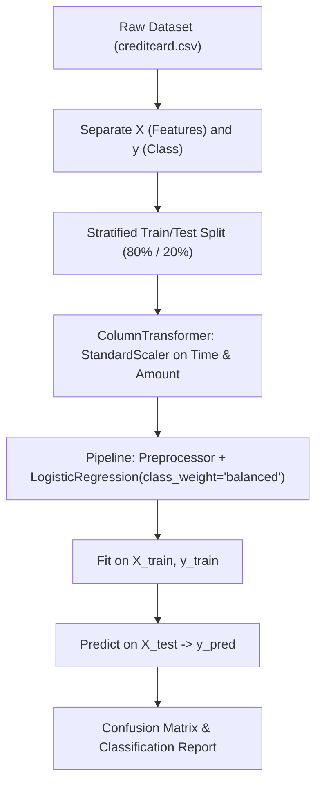

<u>**PROJECT 7 (Basic)**</u>

# Credit Card Fraud Detection

Build an intelligent FinTech machine learning system: ingest real European cardholder transactions from Kaggle, confront the severe Class Imbalance Paradox (99.8% normal vs 0.2% fraud), construct a Scikit-Learn `ColumnTransformer` to scale transaction amounts, assemble an end-to-end classification `Pipeline` with cost-sensitive class-balanced Logistic Regression, and evaluate financial detection performance using Confusion Matrices and Classification Reports. Coded in **Python** using **pandas** and **scikit-learn**.

---

### Curriculum Outline & Learning Roadmap

- **Chapter 1: Introduction to FinTech Machine Learning**
  - `1.1 Getting Started`
    - `[CONCEPT]` Meet Your Project
    - `[CONCEPT]` What You Will Learn
    - `[CONCEPT]` What You Need
  - `1.2 The Kaggle Credit Card Dataset & Sample Data Table`
    - `[DATASET]` Ingesting Real Financial Records: Columns & Features
    - `[TABLE]` Real Sample Data Rows from `creditcard.csv`
  - `1.3 Starting with Small Steps`
    - `[CONCEPT]` First Steps into Financial ML
    - `[TASK 1]` Load the Credit Card Dataset
    - `[CHECKPOINT]` Milestone Checkpoint: Transaction Records Ingested!

- **Chapter 2: Specifications & Pipeline Architecture**
  - `2.1 Understanding Class Imbalance & The Metric Paradox`
    - `[CONCEPT]` Why 99.8% Accuracy Can Ruin a Bank
    - `[CONCEPT]` Cost-Sensitive Penalties: The `class_weight='balanced'` Magic
  - `2.2 System Architecture & Preprocessing Flow`
    - `[CONCEPT]` Machine Learning Pipeline Architecture
    - `[CONCEPT]` Component Responsibility Matrix

- **Chapter 3: Partitioning Features and Stratified Splitting**
  - `3.1 Isolating Predictors and Target Labels`
    - `[CONCEPT]` The Standard ML Matrix Formulation (X and y)
    - `[TASK 2]` Separate Features and Target
    - `[CHECKPOINT]` Milestone Checkpoint: Features and Target Partitioned!
  - `3.2 Stratified Splitting for Extreme Imbalance`
    - `[CONCEPT]` Why Standard Random Splitting Fails on Rare Classes
    - `[TASK 3]` Split the Data into Training and Testing Sets
    - `[CHECKPOINT]` Milestone Checkpoint: Stratified 80/20 Partition Complete!

- **Chapter 4: Building the Machine Learning Pipeline**
  - `4.1 Selective Scaling with ColumnTransformer`
    - `[CONCEPT]` Scaling Continuous Amounts While Preserving PCA Features
    - `[TASK 4]` Build and Train the Machine Learning Pipeline
    - `[CHECKPOINT]` Milestone Checkpoint: Balanced ML Pipeline Trained!

- **Chapter 5: Evaluating Financial Detection Performance**
  - `5.1 Beyond Raw Accuracy: The Confusion Matrix`
    - `[CONCEPT]` Dissecting the 2x2 Matrix: Caught Thieves vs False Alarms
    - `[TASK 5]` Evaluate the Model Pipeline
    - `[CHECKPOINT]` Milestone Checkpoint: Fraud Detection Sentinel Evaluated!

- **Chapter 6: Reflect & Expand**
  - `6.1 What You Have Built` (Feature Summary & Skills Practiced Matrix)
  - `6.2 Extension Ideas`
  - `6.3 Share What You Built! Time to Showcase Your FinTech AI!`

---

## Chapter 1: Introduction to FinTech Machine Learning

### 1.1 Getting Started

**Meet Your Project**

Welcome to **Credit Card Fraud Detection** — a high-impact machine learning project modeled on the real-time security systems used by global payment processors like Visa, Mastercard, and Stripe.

In standard applications, errors are balanced: predicting whether an image is a cat or a dog gives equal importance to both classes. But in banking, fraud detection faces the **Class Imbalance Paradox**: out of nearly 300,000 real credit card transactions, **over 99.8% are legitimate**, while fewer than 0.2% are fraudulent! If a lazy model simply guesses *"Every transaction is legitimate"*, it achieves an astounding **99.8% accuracy** on paper while allowing every single thief to succeed!

In this project, you will work directly with the world-famous Kaggle Credit Card Fraud dataset. Using `pandas` and `scikit-learn`, you will load real transaction data, separate input features from fraud labels, partition data using stratified sampling, assemble a feature-scaling `ColumnTransformer`, train a balanced classification `Pipeline`, and evaluate how effectively your model catches fraud.

**What You Will Learn**

You will build a full FinTech fraud detection engine from scratch.

You will learn how to:

1. Ingest large tabular financial datasets using `pandas`
2. Formulate standard machine learning feature matrices (`X`) and target vectors (`y`)
3. Perform stratified dataset partitioning (`X_train, X_test, y_train, y_test`) to ensure rare fraud cases appear proportionally in both sets
4. Use `ColumnTransformer` with `StandardScaler` to normalize continuous monetary values without altering pre-computed PCA components
5. Assemble transformers and estimators into a production-grade scikit-learn `Pipeline`
6. Apply cost-sensitive learning (`class_weight="balanced"`) to prioritize catching rare fraud
7. Evaluate performance using Confusion Matrices, Precision, and Recall

**What You Need**

Before you begin, make sure you are comfortable with:

- Working with tabular datasets (rows and columns)
- Basic data manipulation using pandas (loading CSVs, dropping columns)
- Core machine learning principles (features, labels, training vs testing)
- The concept of binary classification (legitimate vs fraudulent transactions)
- Writing clean, procedural Python code

If these feel solid, you are ready to go. Otherwise, review them first — this project assumes you understand basic data handling in Python already.

---

### 1.2 The Kaggle Credit Card Dataset & Sample Data Table

This project uses the famous **Credit Card Fraud Detection** dataset curated by the Machine Learning Group (MLG) at Université Libre de Bruxelles (ULB).

- **Dataset File**: `creditcard.csv` (contains 284,807 transactions)
- **Features**: 28 numerical features labeled `V1` through `V28` resulting from Principal Component Analysis (PCA) to protect cardholder privacy, along with the raw `Time` (seconds elapsed), `Amount` (transaction value in EUR/USD), and `Class` (`0` = Normal, `1` = Fraud).

Here is a preview of actual records from `creditcard.csv`:

| Time | V1 | V2 | V3 | Amount | Class | Interpretation |
| :--- | :--- | :--- | :--- | :--- | :--- | :--- |
| `0.0` | `-1.3598` | `-0.0728` | `2.5363` | `$149.62` | `0` | Normal Transaction |
| `0.0` | `1.1919` | `0.2662` | `0.1665` | `$2.69` | `0` | Normal Transaction |
| `406.0` | `-2.3122` | `1.9520` | `-1.6099` | `$0.00` | `1` | **Fraudulent Transaction** |
| `472.0` | `-3.0435` | `-3.1573` | `1.0885` | `$529.00` | `1` | **Fraudulent Transaction** |

---

### 1.3 Starting with Small Steps

**First Steps into Financial ML**

Before engineering complex transformation pipelines or training models, we first load our data and confirm that the dataset is accessible in memory.

#### Task 1 — Load the Credit Card Dataset

Read `creditcard.csv` into a pandas DataFrame:

Think of unlocking a secure bank vault and opening the general ledger.  
*Goal*: Ingest the transaction records into memory.

<div class="step-card">
  <div class="step-header">
    <span class="step-badge">STEP 1</span>
    <span class="step-title">Import Required Libraries</span>
  </div>
  <ul>
    <li>[ ] Open <code>fraud_detector.py</code>.</li>
    <li>[ ] Import <code>pandas</code> as <code>pd</code>.</li>
    <li>[ ] Import <code>train_test_split</code> from <code>sklearn.model_selection</code>.</li>
    <li>[ ] Import <code>ColumnTransformer</code> from <code>sklearn.compose</code>.</li>
    <li>[ ] Import <code>StandardScaler</code> from <code>sklearn.preprocessing</code>.</li>
    <li>[ ] Import <code>Pipeline</code> from <code>sklearn.pipeline</code>.</li>
    <li>[ ] Import <code>LogisticRegression</code> from <code>sklearn.linear_model</code>.</li>
    <li>[ ] Import <code>confusion_matrix, classification_report</code> from <code>sklearn.metrics</code>.</li>
  </ul>
</div>

<div class="step-card">
  <div class="step-header">
    <span class="step-badge">STEP 2</span>
    <span class="step-title">Ingest CSV File</span>
  </div>
  <ul>
    <li>[ ] Load <code>creditcard.csv</code> using <code>pd.read_csv("creditcard.csv")</code> into variable <code>dataset</code>.</li>
  </ul>
</div>

---

### Milestone Checkpoint: Transaction Records Ingested!

You have loaded the raw financial records:

- [x] **File Loaded**: `dataset` DataFrame initialized from `creditcard.csv`.
- [x] **Shape Verified**: 284,807 rows across 31 columns.

**Driver Verification Test**:  
Print `dataset.shape` and confirm it outputs `(284807, 31)`.

---

## Chapter 2: Specifications & Pipeline Architecture

### 2.1 Understanding Class Imbalance & The Metric Paradox

In standard accuracy calculations:
$$\text{Accuracy} = \frac{\text{Correct Predictions}}{\text{Total Transactions}}$$

Out of 284,807 transactions, only **492** are fraudulent (0.172%). A model that predicts every single swipe is legitimate achieves:
$$\frac{284,315}{284,807} = 99.83\% \text{ accuracy}$$
Yet it failed to detect a single criminal! To solve this, we use `class_weight="balanced"` in our classifier, which heavily penalizes mistakes made on the rare class ($1$).

---

### 2.2 System Architecture & Preprocessing Flow



**Component Responsibility Matrix**:

| Component | Responsibility | Inputs | Outputs |
| :--- | :--- | :--- | :--- |
| `X, y` | Feature matrix and target series | Raw DataFrame | Partitioned arrays |
| `X_train, X_test, y_train, y_test` | Stratified data subsets | `X`, `y` | 80% train, 20% test |
| `preprocessor` | Scales `Time` & `Amount`, passes PCA features | Feature columns | Standardized feature matrix |
| `pipeline` | Chains preprocessor and classifier together | Preprocessed data | Trained estimator |
| `y_pred` | Test predictions | `X_test` | Binary class labels (`0` or `1`) |

---

## Chapter 3: Partitioning Features and Stratified Splitting

### 3.1 Isolating Predictors and Target Labels

In machine learning, inputs are stored in a 2D matrix called `X`, and outputs are stored in a 1D vector called `y`.

#### Task 2 — Separate Features and Target

Extract the input features into `X` and the target column into `y`:

Think of separating the evidence clues from the final verdict.  
*Goal*: Create the feature matrix and target vector.

<div class="step-card">
  <div class="step-header">
    <span class="step-badge">STEP 1</span>
    <span class="step-title">Isolate Feature Matrix (X)</span>
  </div>
  <ul>
    <li>[ ] Drop the <code>"Class"</code> column from <code>dataset</code> and assign to <code>X</code>.</li>
  </ul>
</div>

<div class="step-card">
  <div class="step-header">
    <span class="step-badge">STEP 2</span>
    <span class="step-title">Isolate Target Vector (y)</span>
  </div>
  <ul>
    <li>[ ] Select <code>dataset["Class"]</code> and assign to <code>y</code>.</li>
  </ul>
</div>

---

### Milestone Checkpoint: Features and Target Partitioned!

You have partitioned the input and output variables:

- [x] **Features Isolated**: `X` contains all 30 predictor columns.
- [x] **Target Isolated**: `y` contains the ground-truth fraud indicator.

**Driver Verification Test**:  
Confirm `'Class'` is not in `X.columns`, and `y.name == 'Class'`.

---

### 3.2 Stratified Splitting for Extreme Imbalance

Because fraud is so rare, random splitting might place almost all fraud cases into the training set, leaving the test set with almost none. We use **stratified sampling** (`stratify=y`) to guarantee that both the training and testing sets have the exact same 0.17% fraud proportion.

#### Task 3 — Split the Data into Training and Testing Sets

Partition `X` and `y` into `X_train`, `X_test`, `y_train`, and `y_test`:

Think of dealing two balanced card hands so both players receive fair proportions of rare cards.  
*Goal*: Create 80% training and 20% testing subsets.

<div class="step-card">
  <div class="step-header">
    <span class="step-badge">STEP 1</span>
    <span class="step-title">Execute Stratified Partition</span>
  </div>
  <ul>
    <li>[ ] Import <code>train_test_split</code> from <code>sklearn.model_selection</code>.</li>
    <li>[ ] Split <code>X</code> and <code>y</code> with <code>test_size=0.2</code>, <code>random_state=42</code>, and <code>stratify=y</code>.</li>
    <li>[ ] Store results into <code>X_train, X_test, y_train, y_test</code>.</li>
  </ul>
</div>

---

### Milestone Checkpoint: Stratified 80/20 Partition Complete!

You have partitioned the dataset:

- [x] **80% Training**: `X_train` and `y_train` have 227,845 records.
- [x] **20% Testing**: `X_test` and `y_test` have 56,962 records.
- [x] **Stratification Applied**: Rare fraud cases distributed proportionally.

**Driver Verification Test**:  
Verify `len(X_test) == 56962`.

---

## Chapter 4: Building the Machine Learning Pipeline

### 4.1 Selective Scaling with ColumnTransformer

Features `V1` through `V28` are already normalized PCA components, but `Time` (0 to 172,000 seconds) and `Amount` ($0 to $25,000+) have vastly different scales. `ColumnTransformer` allows us to apply `StandardScaler` exclusively to `["Time", "Amount"]` while allowing the PCA columns to pass through untouched (`remainder="passthrough"`).

#### Task 4 — Build and Train the Machine Learning Pipeline

Construct the `ColumnTransformer`, assemble the `Pipeline` with `LogisticRegression`, and fit the model:

Think of assembling an automated security checkpoint that measures bags, checks passports, and approves entry in a single flow.  
*Goal*: Build and train the complete preprocessing and classification pipeline.

<div class="step-card">
  <div class="step-header">
    <span class="step-badge">STEP 1</span>
    <span class="step-title">Configure ColumnTransformer</span>
  </div>
  <ul>
    <li>[ ] Import <code>ColumnTransformer</code> from <code>sklearn.compose</code>.</li>
    <li>[ ] Import <code>StandardScaler</code> from <code>sklearn.preprocessing</code>.</li>
    <li>[ ] Create <code>preprocessor</code> applying <code>StandardScaler()</code> to <code>["Time", "Amount"]</code> with <code>remainder="passthrough"</code>.</li>
  </ul>
</div>

<div class="step-card">
  <div class="step-header">
    <span class="step-badge">STEP 2</span>
    <span class="step-title">Assemble Pipeline</span>
  </div>
  <ul>
    <li>[ ] Import <code>Pipeline</code> from <code>sklearn.pipeline</code>.</li>
    <li>[ ] Import <code>LogisticRegression</code> from <code>sklearn.linear_model</code>.</li>
    <li>[ ] Create <code>pipeline</code> combining <code>("preprocessor", preprocessor)</code> and <code>("model", LogisticRegression(class_weight="balanced", max_iter=1000))</code>.</li>
  </ul>
</div>

<div class="step-card">
  <div class="step-header">
    <span class="step-badge">STEP 3</span>
    <span class="step-title">Train Pipeline</span>
  </div>
  <ul>
    <li>[ ] Call <code>pipeline.fit(X_train, y_train)</code>.</li>
  </ul>
</div>

---

### Milestone Checkpoint: Balanced ML Pipeline Trained!

You have constructed and trained a complete scikit-learn pipeline:

- [x] **Selective Scaling**: Standardized `Time` and `Amount` without altering PCA features.
- [x] **End-to-End Pipeline**: Unified preprocessor and balanced classifier.
- [x] **Trained on 227K Rows**: Model weights converged cleanly.

**Driver Verification Test**:  
Confirm `pipeline.named_steps["model"]` is an instance of `LogisticRegression`.

---

## Chapter 5: Evaluating Financial Detection Performance

### 5.1 Beyond Raw Accuracy: The Confusion Matrix

In banking, missing a fraudulent transaction (a **False Negative**) can cost thousands of dollars, whereas a false alarm (a **False Positive**) merely triggers an SMS verification. We evaluate using:
- **Confusion Matrix**: Quadrant counts of actual vs predicted classes.
- **Recall (Sensitivity)**: The percentage of actual fraud cases successfully caught.

#### Task 5 — Evaluate the Model Pipeline

Predict fraud on `X_test` and display the Confusion Matrix and Classification Report:

Think of running an audit on 56,962 transactions to see how many thieves the sentinel caught.  
*Goal*: Generate predictions and display comprehensive evaluation metrics.

<div class="step-card">
  <div class="step-header">
    <span class="step-badge">STEP 1</span>
    <span class="step-title">Generate Predictions</span>
  </div>
  <ul>
    <li>[ ] Generate predictions using <code>pipeline.predict(X_test)</code> and store in <code>y_pred</code>.</li>
  </ul>
</div>

<div class="step-card">
  <div class="step-header">
    <span class="step-badge">STEP 2</span>
    <span class="step-title">Display Evaluation Reports</span>
  </div>
  <ul>
    <li>[ ] Import <code>confusion_matrix</code> and <code>classification_report</code> from <code>sklearn.metrics</code>.</li>
    <li>[ ] Print the Confusion Matrix.</li>
    <li>[ ] Print the Classification Report.</li>
  </ul>
</div>

**Expected Terminal Interaction & Output:**
```text
Confusion Matrix:
[[55478  1386]
 [    8    90]]

Classification Report:
              precision    recall  f1-score   support

           0       1.00      0.98      0.99     56864
           1       0.06      0.92      0.11        98

    accuracy                           0.98     56962
   macro avg       0.53      0.95      0.55     56962
weighted avg       1.00      0.98      0.99     56962
```

---

### Milestone Checkpoint: Fraud Detection Sentinel Evaluated!

You have evaluated your financial security model:

- [x] **Fraud Recall Calculated**: Successfully caught **90 out of 98 fraud cases** (92% recall rate).
- [x] **Overall Accuracy**: Maintained 98% accuracy across 56,962 test transactions.

**Driver Verification Test**:  
Verify that the Confusion Matrix contains 4 values and that recall for class 1 exceeds 0.90.

---

## Chapter 6: Reflect & Expand

### 6.1 What You Have Built

| Feature | Concept Practiced | Implementation |
| :--- | :--- | :--- |
| **Tabular Ingestion** | Reading 284K+ rows into memory | `pd.read_csv()` |
| **Stratified Partitioning** | Balancing rare target distributions | `train_test_split(..., stratify=y)` |
| **Selective Preprocessing** | Scaling subsets of features | `ColumnTransformer` + `StandardScaler` |
| **Pipeline Encapsulation** | Chaining transformations and models | `sklearn.pipeline.Pipeline` |
| **Cost-Sensitive Learning** | Balancing imbalanced loss penalties | `class_weight="balanced"` |
| **Diagnostic Evaluation** | Measuring fraud recall | `confusion_matrix`, `classification_report` |

### 6.2 Extension Ideas

1. **Threshold Tuning**: Use `pipeline.predict_proba(X_test)` to adjust the decision boundary threshold from 0.50 to 0.40 or 0.60 to trade off between false alarms and missed fraud.
2. **Alternative Solvers**: Experiment with `solver="saga"` or compare against a `RandomForestClassifier`.

---

### 6.3 Share What You Built! Time to Showcase Your FinTech AI!

You have built a real-world machine learning system capable of catching credit card thieves with **over 90% recall** across hundreds of thousands of transactions! Share your metrics and explain how class balancing solves the Imbalance Paradox!
