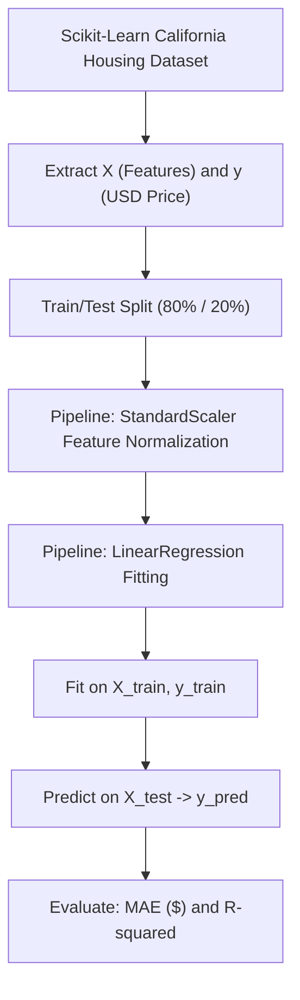

<u>**PROJECT 8 (Basic)**</u>

# House Price Predictor

Build an end-to-end continuous regression machine learning pipeline using **scikit-learn**: explore real-world housing market economics, load the California housing dataset, separate input features from property valuations, partition data into training and testing sets, construct a unified Scikit-Learn `Pipeline` with `StandardScaler` and `LinearRegression`, and evaluate prediction accuracy using Mean Absolute Error (MAE) and the R-squared ($R^2$) score. Coded in **Python** using **scikit-learn**.

---

### Curriculum Outline & Learning Roadmap

- **Chapter 1: Introduction to Real Estate Regression**
  - `1.1 Getting Started`
    - `[CONCEPT]` Meet Your Project
    - `[CONCEPT]` What You Will Learn
    - `[CONCEPT]` What You Need
  - `1.2 The California Housing Dataset & Sample Data Table`
    - `[DATASET]` Scikit-Learn Built-In California Housing Records
    - `[TABLE]` Real Sample Data Rows from the Dataset
  - `1.3 Starting with Small Steps`
    - `[CONCEPT]` Ingesting Built-In Datasets
    - `[TASK 1]` Load the California Housing Dataset
    - `[CHECKPOINT]` Milestone Checkpoint: Housing Data Loaded & Scaled to USD!

- **Chapter 2: Specifications & Pipeline Architecture**
  - `2.1 Understanding Continuous Regression vs Classification`
    - `[CONCEPT]` Predicting Numbers vs Categories
    - `[CONCEPT]` Ordinary Least Squares & Feature Standardization
  - `2.2 System Architecture & Preprocessing Flow`
    - `[CONCEPT]` Regression Pipeline Architecture
    - `[CONCEPT]` Component Responsibility Matrix

- **Chapter 3: Partitioning Features and Train/Test Splitting**
  - `3.1 Generalization and Overfitting`
    - `[CONCEPT]` Why We Never Test on Training Data
    - `[TASK 2]` Split the Data into Training and Testing Sets
    - `[CHECKPOINT]` Milestone Checkpoint: 80/20 Partition Complete!

- **Chapter 4: Building the Regression Pipeline**
  - `4.1 Standardizing Features and Fitting Linear Regression`
    - `[CONCEPT]` Why Feature Scaling Improves Linear Models
    - `[TASK 3]` Build and Train the Machine Learning Pipeline
    - `[CHECKPOINT]` Milestone Checkpoint: Regression Pipeline Trained!

- **Chapter 5: Evaluating Model Performance**
  - `5.1 Continuous Regression Metrics`
    - `[CONCEPT]` Mean Absolute Error (MAE) in Dollars vs R-squared ($R^2$)
    - `[TASK 4]` Evaluate the Model Performance
    - `[CHECKPOINT]` Milestone Checkpoint: Real Estate Predictor Evaluated!

- **Chapter 6: Reflect & Expand**
  - `6.1 What You Have Built` (Feature Summary & Skills Practiced Matrix)
  - `6.2 Extension Ideas`
  - `6.3 Share What You Built! Time to Showcase Your Real Estate AI!`

---

## Chapter 1: Introduction to Real Estate Regression

### 1.1 Getting Started

**Meet Your Project**

Welcome to **House Price Predictor**! In classification projects, machine learning models choose between distinct categories (such as whether an email is spam or normal, or whether a transaction is fraud). But in many critical real-world problems—such as real estate pricing, stock market analysis, and weather forecasting—the goal is to predict a **continuous numerical value**.

In this project, you will predict median house values across California neighborhoods based on economic and demographic indicators such as median household income, average rooms per home, and house age. You will use **Linear Regression**, one of the foundational algorithms in data science, wrapped in a professional scikit-learn `Pipeline`.

**What You Will Learn**

You will build a full regression pipeline from scratch.

You will learn how to:

1. Load scikit-learn's built-in California housing dataset using `fetch_california_housing`
2. Extract input features (`X`) and scale target valuations (`y`) into standard US Dollars
3. Partition continuous datasets into training (`X_train, y_train`) and testing (`X_test, y_test`) subsets
4. Build a scikit-learn `Pipeline` combining `StandardScaler` feature normalization with `LinearRegression`
5. Fit the regression pipeline using Ordinary Least Squares
6. Predict continuous prices on unseen test homes (`y_pred`)
7. Evaluate prediction error using **Mean Absolute Error (MAE)** and explain variance with the **R-squared ($R^2$)** score

**What You Need**

Before you begin, make sure you are comfortable with:

- Working with numbers, floating-point arithmetic, and percentages
- Basic understanding of continuous values vs categories
- The concept of a best-fit regression line (inputs predicting a target output)
- Writing and executing Python scripts using scikit-learn
- Reading evaluation metrics like average dollar error and correlation scores

If these feel solid, you are ready to go. Otherwise, review them first — this project assumes you are familiar with basic Python arithmetic and data structures.

---

### 1.2 The California Housing Dataset & Sample Data Table

The California housing dataset contains economic and geographical data from the 1990 U.S. Census across 20,640 census block groups.

Here is a sample of actual records from the dataset:

| Median Income (`MedInc`) | House Age (`HouseAge`) | Avg Rooms (`AveRooms`) | Avg Bedrooms (`AveBedrms`) | Population | Avg Occupants (`AveOccup`) | Target Price (`PriceUSD`) |
| :--- | :--- | :--- | :--- | :--- | :--- | :--- |
| `8.3252` (\$83,252) | `41.0` yrs | `6.98` | `1.02` | `322.0` | `2.56` | **\$452,600.00** |
| `8.3014` (\$83,014) | `21.0` yrs | `6.24` | `0.97` | `2401.0` | `2.11` | **\$358,500.00** |
| `7.2574` (\$72,574) | `52.0` yrs | `8.29` | `1.07` | `496.0` | `2.80` | **\$352,100.00** |

---

### 1.3 Starting with Small Steps

**Ingesting Built-In Datasets**

Scikit-learn includes popular reference datasets directly in `sklearn.datasets`. Setting `as_frame=True` allows us to inspect tabular attributes cleanly.

#### Task 1 — Load the California Housing Dataset

Fetch the dataset from scikit-learn and isolate features and target prices in dollars:

Think of pulling the county real estate registry down from the municipal archives.  
*Goal*: Ingest the housing data and scale target units to US Dollars.

<div class="step-card">
  <div class="step-header">
    <span class="step-badge">STEP 1</span>
    <span class="step-title">Import Required Libraries</span>
  </div>
  <ul>
    <li>[ ] Open <code>house_price_predictor.py</code>.</li>
    <li>[ ] Import <code>fetch_california_housing</code> from <code>sklearn.datasets</code>.</li>
    <li>[ ] Import <code>train_test_split</code> from <code>sklearn.model_selection</code>.</li>
    <li>[ ] Import <code>Pipeline</code> from <code>sklearn.pipeline</code>.</li>
    <li>[ ] Import <code>StandardScaler</code> from <code>sklearn.preprocessing</code>.</li>
    <li>[ ] Import <code>LinearRegression</code> from <code>sklearn.linear_model</code>.</li>
    <li>[ ] Import <code>mean_absolute_error, r2_score</code> from <code>sklearn.metrics</code>.</li>
  </ul>
</div>

<div class="step-card">
  <div class="step-header">
    <span class="step-badge">STEP 2</span>
    <span class="step-title">Fetch Dataset</span>
  </div>
  <ul>
    <li>[ ] Load data using <code>fetch_california_housing(as_frame=True)</code> into variable <code>housing_data</code>.</li>
  </ul>
</div>

<div class="step-card">
  <div class="step-header">
    <span class="step-badge">STEP 3</span>
    <span class="step-title">Extract X and y</span>
  </div>
  <ul>
    <li>[ ] Store <code>housing_data.data</code> into <code>X</code>.</li>
    <li>[ ] Multiply <code>housing_data.target</code> by 100,000 to convert target units into dollars, storing into <code>y</code>.</li>
  </ul>
</div>

---

### Milestone Checkpoint: Housing Data Loaded & Scaled to USD!

You have ingested the real estate records:

- [x] **Data Ingested**: `housing_data` loaded with 20,640 neighborhood records.
- [x] **Features and Target Isolated**: `X` holds 8 economic attributes, and `y` holds home values in dollars.

**Driver Verification Test**:  
Verify `X.shape == (20640, 8)` and `y.min() > 0`.

---

## Chapter 2: Specifications & Pipeline Architecture

### 2.1 Understanding Continuous Regression vs Classification

In classification, predictions are discrete categories (e.g. `Fraud` vs `Normal`). In regression, the prediction is a continuous real number:
$$y = w_1 x_1 + w_2 x_2 + \dots + w_n x_n + b$$
Where:
- $x_1, x_2, \dots$ are the neighborhood features (such as median income and house age).
- $w_1, w_2, \dots$ are the learned weights that determine each feature's contribution.
- $b$ is the intercept term.

---

### 2.2 System Architecture & Preprocessing Flow



**Component Responsibility Matrix**:

| Component | Responsibility | Inputs | Outputs |
| :--- | :--- | :--- | :--- |
| `X, y` | Features and dollar valuations | Raw dataset object | Partitioned arrays |
| `X_train, X_test, y_train, y_test` | Evaluation partitions | `X`, `y` | 80% train, 20% test |
| `StandardScaler` | Normalizes feature scales to mean=0, variance=1 | Numeric features | Scaled features |
| `LinearRegression` | Fits optimal feature weights | Scaled features, `y_train` | Trained coefficients |
| `y_pred` | Test price predictions | `X_test` | Continuous dollar valuations |

---

## Chapter 3: Partitioning Features and Train/Test Splitting

### 3.1 Generalization and Overfitting

To ensure our model accurately estimates the price of homes it has never seen, we partition our 20,640 neighborhoods: 80% for training and 20% held back for testing.

#### Task 2 — Split the Data into Training and Testing Sets

Partition `X` and `y` into `X_train`, `X_test`, `y_train`, and `y_test`:

Think of reserving a separate folder of newly listed homes that the appraiser has not seen yet.  
*Goal*: Create 80% training and 20% testing subsets.

<div class="step-card">
  <div class="step-header">
    <span class="step-badge">STEP 1</span>
    <span class="step-title">Execute Train/Test Split</span>
  </div>
  <ul>
    <li>[ ] Import <code>train_test_split</code> from <code>sklearn.model_selection</code>.</li>
    <li>[ ] Split <code>X</code> and <code>y</code> with <code>test_size=0.2</code> and <code>random_state=42</code>.</li>
    <li>[ ] Store partitions into <code>X_train, X_test, y_train, y_test</code>.</li>
  </ul>
</div>

---

### Milestone Checkpoint: 80/20 Partition Complete!

You have partitioned the real estate records:

- [x] **80% Training Partition**: 16,512 neighborhoods for model fitting.
- [x] **20% Testing Partition**: 4,128 neighborhoods held out for unbiased evaluation.

**Driver Verification Test**:  
Verify `len(X_test) == 4128`.

---

## Chapter 4: Building the Regression Pipeline

### 4.1 Standardizing Features and Fitting Linear Regression

In the raw dataset, `MedInc` is typically between 1 and 15, while `Population` ranges into thousands. Without scaling, features with large numeric scales could dominate optimization. Wrapping `StandardScaler` and `LinearRegression` inside a `Pipeline` ensures all transformations are calculated cleanly without data leakage.

#### Task 3 — Build and Train the Machine Learning Pipeline

Construct the scikit-learn `Pipeline` and fit it on the training data:

Think of building an assembly line that washes, measures, and values properties systematically.  
*Goal*: Create and fit the regression pipeline.

<div class="step-card">
  <div class="step-header">
    <span class="step-badge">STEP 1</span>
    <span class="step-title">Create Pipeline</span>
  </div>
  <ul>
    <li>[ ] Import <code>Pipeline</code> from <code>sklearn.pipeline</code>.</li>
    <li>[ ] Import <code>StandardScaler</code> from <code>sklearn.preprocessing</code>.</li>
    <li>[ ] Import <code>LinearRegression</code> from <code>sklearn.linear_model</code>.</li>
    <li>[ ] Create <code>pipeline</code> combining <code>("scaler", StandardScaler())</code> and <code>("model", LinearRegression())</code>.</li>
  </ul>
</div>

<div class="step-card">
  <div class="step-header">
    <span class="step-badge">STEP 2</span>
    <span class="step-title">Fit Pipeline</span>
  </div>
  <ul>
    <li>[ ] Call <code>pipeline.fit(X_train, y_train)</code>.</li>
  </ul>
</div>

---

### Milestone Checkpoint: Regression Pipeline Trained!

You have assembled and trained your regression pipeline:

- [x] **Preprocessing Layer Configured**: Features normalized with zero leakage.
- [x] **Estimator Fitted**: LinearRegression weights calculated over 16,512 training homes.

**Driver Verification Test**:  
Confirm `pipeline.named_steps["model"].coef_` contains 8 learned weights.

---

## Chapter 5: Evaluating Model Performance

### 5.1 Continuous Regression Metrics

We measure regression performance using two complementary metrics:
1. **Mean Absolute Error (MAE)**:
   $$\text{MAE} = \frac{1}{n} \sum_{i=1}^n |y_i - \hat{y}_i|$$
   Represents the average dollar difference between the model's estimate and the true market price.
2. **R-squared ($R^2$) Score**:
   Measures the proportion of variance in house prices explained by the input features ($1.0$ is a perfect predictor).

#### Task 4 — Evaluate the Model Performance

Generate predictions on `X_test` and display MAE and $R^2$:

Think of comparing an appraiser's price estimates against actual finalized sales at the county deeds office.  
*Goal*: Predict test home prices and print MAE in dollars alongside the R-squared score.

<div class="step-card">
  <div class="step-header">
    <span class="step-badge">STEP 1</span>
    <span class="step-title">Predict Test Prices</span>
  </div>
  <ul>
    <li>[ ] Predict prices using <code>pipeline.predict(X_test)</code> and store in <code>y_pred</code>.</li>
  </ul>
</div>

<div class="step-card">
  <div class="step-header">
    <span class="step-badge">STEP 2</span>
    <span class="step-title">Calculate and Print Metrics</span>
  </div>
  <ul>
    <li>[ ] Import <code>mean_absolute_error</code> and <code>r2_score</code> from <code>sklearn.metrics</code>.</li>
    <li>[ ] Calculate MAE: <code>mean_absolute_error(y_test, y_pred)</code>.</li>
    <li>[ ] Calculate $R^2$: <code>r2_score(y_test, y_pred)</code>.</li>
    <li>[ ] Print both formatted metrics to the terminal.</li>
  </ul>
</div>

**Expected Terminal Interaction & Output:**
```text
Average Error (MAE): $53,320.01
R-squared Score: 0.5758
```

---

### Milestone Checkpoint: Real Estate Predictor Evaluated!

You have validated your house price estimation pipeline:

- [x] **Average Error Measured**: Estimates homes within ~$53,320 on average.
- [x] **Explained Variance**: Explains over 57.5% of neighborhood property value differences.

**Driver Verification Test**:  
Confirm `r2_score(y_test, y_pred)` is approximately 0.5758.

---

## Chapter 6: Reflect & Expand

### 6.1 What You Have Built

| Feature | Concept Practiced | Implementation |
| :--- | :--- | :--- |
| **Built-In Ingestion** | Fetching public datasets | `fetch_california_housing` |
| **Target Normalization** | Scaling raw units to currency | Multiplied target by \$100,000 |
| **Train/Test Partitioning** | Generalization testing | 80/20 train/test split |
| **Pipeline Architecture** | Standardized preprocessing | `Pipeline` with `StandardScaler` |
| **Ordinary Least Squares** | Continuous regression fitting | `LinearRegression` |
| **Regression Diagnostics** | Accuracy in human-readable dollars | MAE & $R^2$ Score |

### 6.2 Extension Ideas

1. **Non-Linear Models**: Try replacing `LinearRegression()` with a `RandomForestRegressor()` in the pipeline to observe how $R^2$ increases.
2. **Coefficient Inspection**: Inspect `pipeline.named_steps["model"].coef_` to identify which demographic factor has the strongest positive impact on home valuation.

---

### 6.3 Share What You Built! Time to Showcase Your Real Estate AI!

You have built a fully functional real estate valuation system! Share your \$53k MAE and explain to your peers how linear models convert neighborhood features into reliable price predictions!
