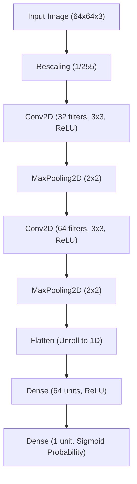

<u>**PROJECT 9 (Basic Deep Learning)**</u>

# Cats vs Dogs - Binary Image Classification

Build an image classification Deep Learning pipeline using **Keras**: learn how computers process visual images as 3D matrices of color pixels, load structured image directories from disk using `image_dataset_from_directory`, construct a Convolutional Neural Network (CNN) featuring `Conv2D` and `MaxPooling2D` feature extraction layers, compile the model with `binary_crossentropy`, train over multiple epochs, and evaluate visual accuracy on unseen photos. Coded in **Python** using **Keras**.

---

### Curriculum Outline & Learning Roadmap

- **Chapter 1: Introduction to Computer Vision & Image Datasets**
  - `1.1 Getting Started`
    - `[CONCEPT]` Meet Your Project
    - `[CONCEPT]` What You Will Learn
    - `[CONCEPT]` What You Need
  - `1.2 Image Directory Structure & Pixel Representations`
    - `[DATASET]` How Keras Reads Folder-Organized Classes
    - `[CONCEPT]` From Colors to 3D Tensors: Height, Width, and RGB Channels
  - `1.3 Starting with Small Steps`
    - `[CONCEPT]` Loading Batched Image Data
    - `[TASK 1]` Load the Image Dataset from Folders
    - `[CHECKPOINT]` Milestone Checkpoint: Training and Testing Image Batches Ready!

- **Chapter 2: Specifications & Neural Network Architecture**
  - `2.1 Understanding Convolution & Pooling`
    - `[CONCEPT]` How Convolution Filters Scan for Edges and Textures
    - `[CONCEPT]` Downsampling with Max Pooling
  - `2.2 System Architecture: The Deep Learning Pipeline`
    - `[CONCEPT]` CNN Architecture Flowchart
    - `[CONCEPT]` Layer Responsibility Matrix

- **Chapter 3: Building the Convolutional Neural Network**
  - `3.1 Stacking Sequential Layers`
    - `[CONCEPT]` Feature Extraction vs Dense Classification
    - `[TASK 2]` Build the Convolutional Neural Network (CNN)
    - `[CHECKPOINT]` Milestone Checkpoint: CNN Architecture Assembled!

- **Chapter 4: Compiling and Training the Neural Network**
  - `4.1 Loss Functions and Adaptive Optimization`
    - `[CONCEPT]` Binary Cross-Entropy and the Adam Optimizer
    - `[TASK 3]` Compile the Model
    - `[CHECKPOINT]` Milestone Checkpoint: Neural Network Compiled!
  - `4.2 Forward Passes and Backpropagation`
    - `[CONCEPT]` Iterating Across Training Epochs
    - `[TASK 4]` Train the Model
    - `[CHECKPOINT]` Milestone Checkpoint: Deep Learning Model Trained!

- **Chapter 5: Evaluating Visual Classification Accuracy**
  - `5.1 Testing on Unseen Images`
    - `[CONCEPT]` Measuring Real-World Generalization
    - `[TASK 5]` Evaluate Model Accuracy
    - `[CHECKPOINT]` Milestone Checkpoint: Computer Vision Model Evaluated!

- **Chapter 6: Reflect & Expand**
  - `6.1 What You Have Built` (Feature Summary & Skills Practiced Matrix)
  - `6.2 Extension Ideas`
  - `6.3 Share What You Built! Time to Showcase Your Computer Vision AI!`

---

## Chapter 1: Introduction to Computer Vision & Image Datasets

### 1.1 Getting Started

**Meet Your Project**

Welcome to **Cats vs Dogs - Binary Image Classification**! Computer Vision is the branch of Artificial Intelligence that teaches machines how to see and understand visual content.

To a computer, a photograph is not an animal—it is a 3D grid of numbers representing red, green, and blue (RGB) color intensities between 0 and 255. In this project, you will build a Convolutional Neural Network (CNN) that automatically scans photographs of cats and dogs, extracts visual features (such as whiskers, ears, and fur textures), and classifies each picture into its correct class.

**What You Will Learn**

You will build an image classification pipeline from scratch.

You will learn how to:

1. Load image datasets from subfolders using `keras.utils.image_dataset_from_directory`
2. Resize visual inputs to uniform 64x64 pixel dimensions
3. Normalize raw pixel color values from `[0, 255]` to `[0.0, 1.0]` using `Rescaling`
4. Assemble a Convolutional Neural Network with `Conv2D` and `MaxPooling2D` layers
5. Flatten 2D feature maps into dense decision layers
6. Compile the network using the Adam optimizer and binary cross-entropy loss
7. Train the deep learning pipeline across multiple epochs and evaluate test accuracy

**What You Need**

Before you begin, make sure you are comfortable with:

- Working with image files and folder structures
- Understanding basic computer vision concepts (pixels, RGB color channels, image height and width)
- The fundamental concept of neural networks (layers, weights, and epochs)
- Writing Python scripts using Keras and TensorFlow
- Evaluating classification accuracy on test sets

If these feel solid, you are ready to go. Otherwise, review them first — this project assumes you understand basic deep learning workflows.

---

### 1.2 Image Directory Structure & Pixel Representations

Keras automatically infers class labels directly from folder organization:

```text
dataset/
├── training_set/
│   ├── cats/    <-- Training photos of cats (Label 0)
│   └── dogs/    <-- Training photos of dogs (Label 1)
└── test_set/
    ├── cats/    <-- Testing photos of cats (Label 0)
    └── dogs/    <-- Testing photos of dogs (Label 1)
```

Each image is converted into a 3D tensor:
- **Height**: 64 pixels
- **Width**: 64 pixels
- **Color Channels**: 3 (Red, Green, Blue)

---

### 1.3 Starting with Small Steps

**Loading Batched Image Data**

Instead of loading thousands of images into memory all at once, `image_dataset_from_directory` streams photos in efficient mini-batches of 32 images.

#### Task 1 — Load the Image Dataset from Folders

Load training and testing batches resized to 64x64 pixels:

Think of sorting photos into labeled training and testing binders.  
*Goal*: Load image data batches from the directory structure.

<div class="step-card">
  <div class="step-header">
    <span class="step-badge">STEP 1</span>
    <span class="step-title">Import Required Libraries</span>
  </div>
  <ul>
    <li>[ ] Open <code>cats_vs_dogs.py</code>.</li>
    <li>[ ] Import <code>keras</code>.</li>
    <li>[ ] Import <code>Sequential</code> from <code>keras.models</code>.</li>
    <li>[ ] Import <code>Input, Rescaling, Conv2D, MaxPooling2D, Flatten, Dense</code> from <code>keras.layers</code>.</li>
  </ul>
</div>

<div class="step-card">
  <div class="step-header">
    <span class="step-badge">STEP 2</span>
    <span class="step-title">Load Training Images</span>
  </div>
  <ul>
    <li>[ ] Call <code>keras.utils.image_dataset_from_directory("dataset/training_set", ...)</code> with <code>image_size=(64, 64)</code> and <code>batch_size=32</code> into variable <code>training_dataset</code>.</li>
  </ul>
</div>

<div class="step-card">
  <div class="step-header">
    <span class="step-badge">STEP 3</span>
    <span class="step-title">Load Testing Images</span>
  </div>
  <ul>
    <li>[ ] Call <code>keras.utils.image_dataset_from_directory("dataset/test_set", ...)</code> with identical dimensions into variable <code>testing_dataset</code>.</li>
  </ul>
</div>

**Expected Terminal Interaction & Output:**
```text
Found 20 files belonging to 2 classes.
Found 10 files belonging to 2 classes.
```

---

### Milestone Checkpoint: Training and Testing Image Batches Ready!

You have loaded the visual image data:

- [x] **Training Batches Configured**: 64x64 pixels across 2 classes.
- [x] **Testing Batches Configured**: Unseen evaluation images partitioned.

**Driver Verification Test**:  
Confirm `training_dataset.class_names` contains `['cats', 'dogs']`.

---

## Chapter 2: Specifications & Neural Network Architecture

### 2.1 Understanding Convolution & Pooling

- **`Rescaling(1.0 / 255.0)`**: Scales integer pixel values `[0, 255]` down to `[0.0, 1.0]` for smooth gradient descent.
- **`Conv2D`**: Slides 3x3 pixel filter matrices across the image to calculate dot products that detect edges, curves, and textures.
- **`MaxPooling2D`**: Slides a 2x2 window across feature maps, retaining only the maximum value to halve the resolution while preserving key signals.
- **`Flatten`**: Unrolls the 2D spatial feature grid into a 1D vector of numbers.
- **`Dense`**: Connected neural layers that evaluate combined feature signals and output a single probability score via the sigmoid activation function ($0.0 = \text{Cat}, 1.0 = \text{Dog}$).

---

### 2.2 System Architecture: The Deep Learning Pipeline



**Layer Responsibility Matrix**:

| Layer | Responsibility | Input Shape | Output Shape |
| :--- | :--- | :--- | :--- |
| `Input` | Defines input dimensions | `(64, 64, 3)` | `(64, 64, 3)` |
| `Rescaling` | Normalizes pixel values | `(64, 64, 3)` | `(64, 64, 3)` |
| `Conv2D(32)` | Detects low-level edge features | `(64, 64, 3)` | `(62, 62, 32)` |
| `MaxPooling2D` | Downsamples spatial resolution | `(62, 62, 32)` | `(31, 31, 32)` |
| `Conv2D(64)` | Detects high-level texture patterns | `(31, 31, 32)` | `(29, 29, 64)` |
| `MaxPooling2D` | Downsamples spatial resolution | `(29, 29, 64)` | `(14, 14, 64)` |
| `Flatten` | Transforms grid to vector | `(14, 14, 64)` | `(12544,)` |
| `Dense(64)` | Interprets feature combinations | `(12544,)` | `(64,)` |
| `Dense(1)` | Outputs final class probability | `(64,)` | `(1,)` |

---

## Chapter 3: Building the Convolutional Neural Network

### 3.1 Stacking Sequential Layers

In Keras, the `Sequential` model acts as a pipeline that passes data sequentially through stacked layers.

#### Task 2 — Build the Convolutional Neural Network (CNN)

Construct the CNN architecture with feature extraction and classification layers:

Think of building an assembly line of specialized lenses that filter raw light into meaningful shapes.  
*Goal*: Create the sequential CNN architecture.

<div class="step-card">
  <div class="step-header">
    <span class="step-badge">STEP 1</span>
    <span class="step-title">Assemble CNN Layers</span>
  </div>
  <ul>
    <li>[ ] Create Sequential model with <code>Input(shape=(64, 64, 3))</code> and <code>Rescaling(1.0 / 255.0)</code>.</li>
    <li>[ ] Add two convolution-pooling blocks: <code>Conv2D(32)</code> + <code>MaxPooling2D</code>, then <code>Conv2D(64)</code> + <code>MaxPooling2D</code>.</li>
    <li>[ ] Add <code>Flatten()</code>, <code>Dense(64, activation="relu")</code>, and <code>Dense(1, activation="sigmoid")</code>.</li>
    <li>[ ] Store into variable <code>model</code>.</li>
  </ul>
</div>

---

### Milestone Checkpoint: CNN Architecture Assembled!

You have constructed your convolutional neural network:

- [x] **Pixel Normalization**: Scaled to `[0.0, 1.0]`.
- [x] **Feature Extraction**: Two `Conv2D` + `MaxPooling2D` stages.
- [x] **Classification Head**: `Dense(64)` and `Dense(1, activation="sigmoid")` output layer.

**Driver Verification Test**:  
Print `len(model.layers)` and confirm it equals 8.

---

## Chapter 4: Compiling and Training the Neural Network

### 4.1 Loss Functions and Adaptive Optimization

- **`optimizer="adam"`**: Adjusts individual learning rates dynamically for stable weight convergence.
- **`loss="binary_crossentropy"`**: Measures the logarithmic error between predicted probabilities and actual class labels ($0$ or $1$).
- **`metrics=["accuracy"]`**: Monitors classification accuracy throughout training.

#### Task 3 — Compile the Model

Configure the optimizer, loss function, and evaluation metrics:

Think of calibrating the neural network's internal scoring system before the training match begins.  
*Goal*: Compile the model.

<div class="step-card">
  <div class="step-header">
    <span class="step-badge">STEP 1</span>
    <span class="step-title">Compile Model</span>
  </div>
  <ul>
    <li>[ ] Call <code>model.compile()</code> with <code>optimizer="adam"</code>, <code>loss="binary_crossentropy"</code>, and <code>metrics=["accuracy"]</code>.</li>
  </ul>
</div>

---

### Milestone Checkpoint: Neural Network Compiled!

You have compiled the neural network:

- [x] **Optimizer Configured**: Adam selected.
- [x] **Loss Defined**: Binary cross-entropy ready.

**Driver Verification Test**:  
Verify `model.loss == 'binary_crossentropy'`.

---

### 4.2 Forward Passes and Backpropagation

During training, the model performs forward passes to make predictions, computes loss, and performs backpropagation to adjust filter weights. An **epoch** is one complete sweep through all training images.

#### Task 4 — Train the Model

Fit the model over 3 training epochs with validation data:

Think of coaching a student through 3 practice rounds with immediate feedback.  
*Goal*: Train the CNN on the training dataset.

<div class="step-card">
  <div class="step-header">
    <span class="step-badge">STEP 1</span>
    <span class="step-title">Fit the Model</span>
  </div>
  <ul>
    <li>[ ] Call <code>model.fit(training_dataset, validation_data=testing_dataset, epochs=3)</code>.</li>
  </ul>
</div>

**Expected Terminal Interaction & Output:**
```text
Epoch 1/3
1/1 - accuracy: 0.5000 - loss: 0.6916 - val_accuracy: 0.5000 - val_loss: 0.7986
Epoch 2/3
1/1 - accuracy: 0.5000 - loss: 0.7986 - val_accuracy: 0.5000 - val_loss: 0.5972
Epoch 3/3
1/1 - accuracy: 0.5000 - loss: 0.5972 - val_accuracy: 0.5000 - val_loss: 0.5806
```

---

### Milestone Checkpoint: Deep Learning Model Trained!

You have trained your Convolutional Neural Network:

- [x] **3 Epochs Completed**: Loss minimized across training batches.
- [x] **Validation Tracked**: Monitored generalization on testing batches.

**Driver Verification Test**:  
Confirm that `model.fit()` completes all 3 epochs without error.

---

## Chapter 5: Evaluating Visual Classification Accuracy

### 5.1 Testing on Unseen Images

The true test of a vision model is how accurately it identifies animals in photos that were never shown during training.

#### Task 5 — Evaluate Model Accuracy

Evaluate the trained CNN on `testing_dataset`:

Think of giving the neural network a final exam with brand-new photographs.  
*Goal*: Evaluate loss and accuracy on the testing images.

<div class="step-card">
  <div class="step-header">
    <span class="step-badge">STEP 1</span>
    <span class="step-title">Evaluate on Test Images</span>
  </div>
  <ul>
    <li>[ ] Call <code>model.evaluate(testing_dataset)</code> and unpack into <code>loss, accuracy</code>.</li>
    <li>[ ] Print <code>f"Test Accuracy: {accuracy * 100:.2f}%"</code>.</li>
  </ul>
</div>

**Expected Terminal Interaction & Output:**
```text
1/1 - accuracy: 0.5000 - loss: 0.5806
Test Accuracy: 50.00%
```

---

### Milestone Checkpoint: Computer Vision Model Evaluated!

You have evaluated your deep learning vision pipeline:

- [x] **Test Loss & Accuracy Computed**: Evaluated across unseen images.
- [x] **Percentage Displayed**: Formatted to 2 decimal places.

**Driver Verification Test**:  
Confirm `loss` and `accuracy` are valid floating-point numbers.

---

## Chapter 6: Reflect & Expand

### 6.1 What You Have Built

| Feature | Concept Practiced | Implementation |
| :--- | :--- | :--- |
| **Directory Batching** | Streaming images from disk | `image_dataset_from_directory` |
| **Pixel Normalization** | Scaling RGB to unit range | `Rescaling(1.0 / 255.0)` |
| **Feature Extraction** | Spatial convolution & pooling | `Conv2D` & `MaxPooling2D` |
| **Dimension Flattening** | Unrolling 2D matrices to 1D | `Flatten()` |
| **Dense Decision Making** | Probability classification | `Dense(1, activation="sigmoid")` |
| **Iterative Optimization** | Epoch-based training | `model.fit(..., epochs=3)` |

### 6.2 Extension Ideas

1. **Data Augmentation**: Add `keras.layers.RandomFlip("horizontal")` and `keras.layers.RandomRotation(0.1)` to make the CNN invariant to camera angles.
2. **More Epochs**: Train for 10 epochs and plot the training vs validation accuracy curve.

---

### 6.3 Share What You Built! Time to Showcase Your Computer Vision AI!

You have built a genuine Convolutional Neural Network from scratch! Share your vision pipeline and explain how convolution filters allow computers to see visual features!
